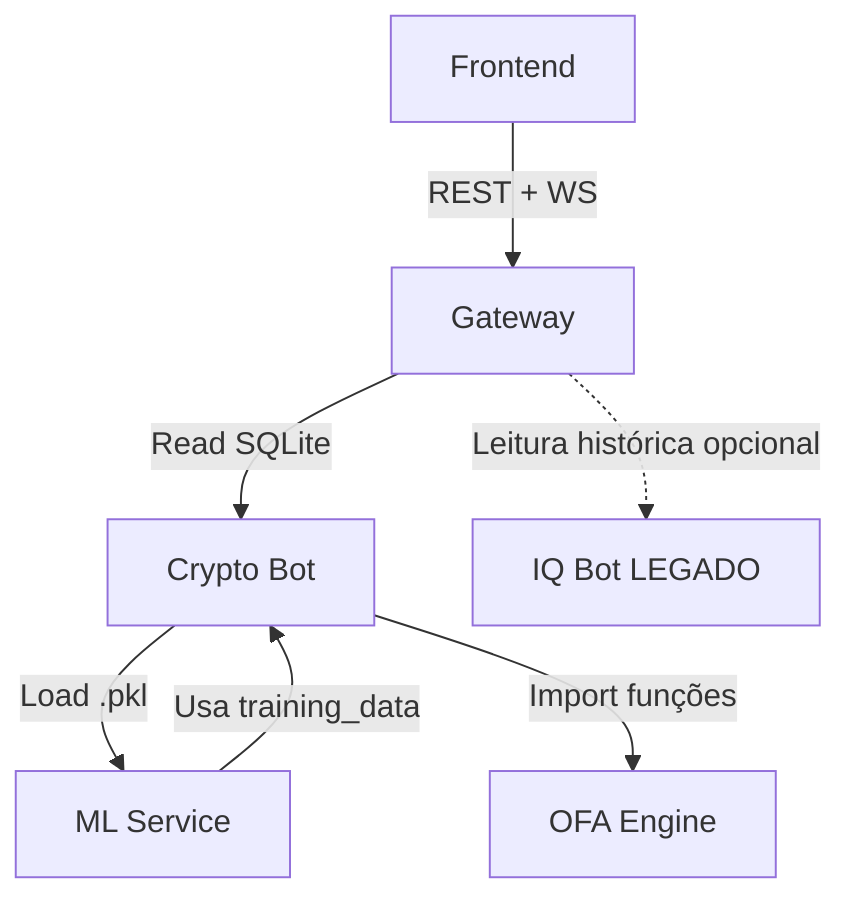

# EOS — Sistema de Sinais de Cripto (Hub) ✅ REVISADO

> **Propósito:** Mapa centralizado do ecossistema EOS. Consulte para entender módulos, contratos e fluxos de dados.

---

## 📦 Módulos (Status)

| Módulo | Status | Responsabilidade | Link |
|--------|--------|------------------|------|
| **Frontend** | ✅ Ativo | Dashboard React (SPA) | [`src/agents.md`](./src/agents.md) |
| **Gateway** | ✅ Ativo | API Hub + WebSocket (Proxy reverso) | [`eos-gateway/agents.md`](./eos-gateway/agents.md) |
| **Crypto Bot** | ✅ Ativo | Bot principal (Binance + Telegram) | [`eos-telegram-bot/agents.md`](./eos-telegram-bot/agents.md) |
| **ML Service** | ✅ Ativo | Pipeline de treino e geração de modelos | [`eos-ml/agents.md`](./eos-ml/agents.md) |
| **OFA Engine** | ✅ Ativo | Lib compartilhada (math puro, stateless) | [`eos-ofa-engine/agents.md`](./eos-ofa-engine/agents.md) |
| **IQ Bot** | ⚠️ Legado | Forex/IQ Option (somente leitura histórica) | [`eos-iq-bot/agents.md`](./eos-iq-bot/agents.md) |

---

## 🔗 Grafo de Dependências

---

## 📜 Contratos Globais (Fonte da Verdade)

### 1) Signal (Payload principal)
- **Definição canônica:** Interface `TradingSignal` em [`src/lib/signalApi.ts`](./src/lib/signalApi.ts) (Frontend).
- **Persistência:** Tabela `signals` em `eos-telegram-bot/data/eos.db`.
- **Transformação:** DB row → JSON `TradingSignal` (via Gateway).
- **Transporte:** REST (`GET /api/signals`) + WebSocket (`new_signal`).

**Campos obrigatórios (v1.0):**
- `symbol` (string, ex: BTCUSDT)
- `action` ("BUY" | "SELL")
- `price` (number, preço de entrada)
- `timestamp` (ISO 8601 ou Unix, gerado pelo Bot)
- `stopLoss` (number | null, opcional)
- `takeProfit` (number | null, opcional)

**Versionamento:** se adicionar/remover campos obrigatórios, considerar breaking change e bump de versão.

### 2) Schema de Features (ML)
- **Definição:** Interface `MLSignalFeatures` em [`eos-telegram-bot/src/mlService.ts`](./eos-telegram-bot/src/mlService.ts).
- **Features atuais (v1.0):**
  - `f_smart_money` (number)
  - `f_imbalance` (number)
  - `f_absorption` (number)
- **Artefatos:** Modelos `.pkl` em `eos-ml/models/` (gerados pelo pipeline de treino).

**Breaking Change:** Adicionar/remover/renomear feature exige:
1. Atualizar interface `MLSignalFeatures`
2. Retreinar modelos em `eos-ml`
3. Validar compatibilidade de shape antes de deploy
4. Documentar mudança no `CHANGELOG.md` ou ADR

### 3) Database (SQLite)
- **Crypto (principal):** `eos-telegram-bot/data/eos.db`
  - Tabelas: `signals`, `training_data`
  - Migrations: Gerenciadas via código em `eos-telegram-bot/src/sqliteDatabase.ts`
- **Legado (IQ Bot):** `eos-iq-bot/data/eos-iq.db`
  - Status: somente leitura para histórico (Gateway pode acessar opcionalmente)
  - Objetivo futuro: migrar dados relevantes → `eos.db` e descontinuar

### 4) Eventos WebSocket
- **Canal:** Socket.io no Gateway (porta configurada via `.env`)
- **Eventos (v1.0):**
  - `connection`: Cliente conectado (ack automático)
  - `new_signal`: Broadcast de novo sinal (payload = `TradingSignal` JSON)

---

## ☑️ Regras de Compatibilidade (Cross-Módulo)

Ao modificar qualquer contrato global, siga este checklist obrigatório:

- [ ] **Signal (tipos/fields):**
  - Atualizar `TradingSignal` em `src/lib/signalApi.ts`
  - Atualizar queries SQL e mapper no Gateway (`eos-gateway/server.js`)
  - Atualizar insert/update no Crypto Bot (`eos-telegram-bot/src/sqliteDatabase.ts`)
  - Testar WS + REST com payload real
  - Se breaking change: bump de versão de API e documentar

- [ ] **ML Features (schema de input):**
  - Atualizar interface `MLSignalFeatures` em `eos-telegram-bot/src/mlService.ts`
  - Ajustar feature engineering em `eos-ml` (pipeline de treino)
  - Retreinar modelos e validar shape de input/output
  - Substituir `.pkl` antigos
  - Validar compatibilidade de versão em runtime (se possível, adicionar check de versão no .pkl ou meta.json)

- [ ] **Database Schema:**
  - Criar script de migração (SQL ou código) em `eos-telegram-bot/src/sqliteDatabase.ts`
  - Atualizar queries no Gateway
  - Testar rollback (se aplicável)
  - Documentar no `agents.md` do Crypto Bot

---

## 🧠 Skills Aplicadas (Referência Global)

Este projeto utiliza skills do índice global para orientar desenvolvimento. Sempre liste os skills no início de cada tarefa conforme regra global.

**Skills principais:**
- `backend-architect`: Arquitetura de API e serviços
- `api-design-principles`: Design de contratos REST/WS
- `async-python-patterns`: Pipeline ML e processamento assíncrono
- `backtesting-frameworks`: Validação de sinais (roadmap)
- `api-testing-observability-api-mock`: Testes e mocks

**Índice completo:** `~/.gemini/antigravity/Skills/awesome-skills/skills_index.json`

---

## 🚀 Roadmap & Decisões Arquiteturais

### Próximos passos sugeridos:
- [x] Formalizar contratos (FEITO neste hub)
- [ ] Criar ADR (Architecture Decision Records) para decisões críticas (ex.: escolha SQLite vs Postgres, estrutura de features ML)
- [ ] Implementar validação de contrato em runtime (Zod no Gateway, Pydantic no ML)
- [ ] Migrar histórico IQ Bot → `eos.db` e descontinuar `eos-iq.db`
- [ ] Adicionar versionamento de modelo ML (meta.json com versão + libs)

### Decisões pendentes:
- [ ] Autenticação no Gateway (JWT/OAuth? ou manter localhost-only?)
- [ ] Estratégia de deploy (Docker Compose atual? Migrar pra K8s?)
- [ ] Backup e disaster recovery do SQLite (cron? replicação?)

---

## 📌 Referências Rápidas

- **Comandos:** Ver `package.json` ou scripts em cada módulo
- **Logs:** `docker-compose logs -f [service]` (se dockerizado) ou logs locais por módulo
- **Testes:** Ver seção de testes em cada `agents.md` específico

---

**Última atualização:** 01/02/2026
**Mantedor:** @sairo (Analista TI, R|Fonseca / S-Iron.tech)
