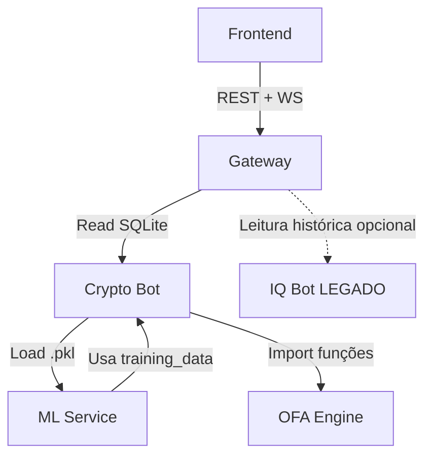

# EOS — Sistema de Sinais de Cripto (Hub)

> **Propósito:** Mapa centralizado do ecossistema EOS. Consulte para entender módulos, contratos e fluxos de dados.

---

## Módulos (Status)

| Módulo | Status | Responsabilidade | Link |
| ------ | ------ | ---------------- | ---- |
| **Frontend** | Ativo | Dashboard React (SPA) | [`src/agents.md`](./src/agents.md) |
| **Gateway** | Ativo | API Hub + WebSocket (Proxy reverso) | [`eos-gateway/agents.md`](./eos-gateway/agents.md) |
| **Crypto Bot** | Ativo | Bot principal (Binance + Telegram) | [`eos-telegram-bot/agents.md`](./eos-telegram-bot/agents.md) |
| **ML Service** | Ativo | Pipeline de treino e geração de modelos | [`eos-ml/agents.md`](./eos-ml/agents.md) |
| **OFA Engine** | Ativo | Lib compartilhada (math puro, stateless) | [`eos-ofa-engine/agents.md`](./eos-ofa-engine/agents.md) |
| **IQ Bot** | Legado | Forex/IQ Option (somente leitura histórica) | [`eos-iq-bot/agents.md`](./eos-iq-bot/agents.md) |

---

## Grafo de Dependências

---

## Contratos Globais (Fonte da Verdade)

### Signal (Payload principal)

- **Definição canônica:** Interface `TradingSignal` em [`src/lib/signalApi.ts`](./src/lib/signalApi.ts) (Frontend).
- **Persistência:** Tabela `signals` em `eos-telegram-bot/data/eos.db`.
- **Transformação:** DB row → JSON `TradingSignal` (via Gateway).
- **Transporte:** REST (`GET /api/signals`) + WebSocket (`new_signal`).

**Campos obrigatórios (v1.0):**

- `symbol` — string, ex: BTCUSDT
- `action` — "BUY" | "SELL"
- `price` — number, preço de entrada
- `timestamp` — ISO 8601 ou Unix, gerado pelo Bot
- `stopLoss` — number | null
- `takeProfit` — number | null

### Schema de Features ML (entrada)

- **Definição:** Interface `MLSignalFeatures` em [`eos-telegram-bot/src/mlService.ts`](./eos-telegram-bot/src/mlService.ts).
- **Features atuais (v1.0):** `f_smart_money`, `f_imbalance`, `f_absorption`, `f_price_context`, `f_trend`, `f_momentum`, `f_volume`.
- **Artefatos:** Modelos `.pkl` em `data/ml/models/` (gerados pelo pipeline de treino).

**Breaking Change:** Adicionar/remover/renomear feature exige retreino completo + validação de shape.

### Schema de Features ML (saída — Exit Decision Engine)

- **Definição:** Interface `ExitFeatures` em [`eos-telegram-bot/src/exitDecisionEngine.ts`](./eos-telegram-bot/src/exitDecisionEngine.ts).
- **Features (14):** `pnl_pct`, `time_in_trade_seconds`, `distance_to_stop_pct`, `distance_to_target_pct`, `volume_ratio`, `volatility_5m`, `volatility_15m`, `volatility_ratio`, `rsi_current`, `rsi_slope`, `candles_in_favor`, `candles_against`, `original_signal_score`, `bid_ask_spread_pct`.
- **Modelo:** `data/ml/models/exit_model.pkl` — LightGBM binário (EXIT vs HOLD).
- **Retreino:** automático via `ExitModelRecalibrationService` a cada 30 novas operações fechadas.

### Database (SQLite)

- **Crypto (principal):** `eos-telegram-bot/data/eos.db`
  - Tabelas: `signals`, `training_data`, `price_checkpoints`, `exit_decisions_log`, `app_settings`
  - Migrations: gerenciadas via código em `eos-telegram-bot/src/sqliteDatabase.ts`
- **Legado (IQ Bot):** `eos-iq-bot/data/eos-iq.db`
  - Status: somente leitura para histórico

### Eventos WebSocket

- **Canal:** Socket.io no Gateway (porta configurada via `.env`)
- **Eventos (v1.0):**
  - `connection` — cliente conectado (ack automático)
  - `new_signal` — broadcast de novo sinal (payload = `TradingSignal` JSON)

---

## Regras de Compatibilidade (Cross-Módulo)

Ao modificar qualquer contrato global, siga este checklist:

- [ ] **Signal (tipos/fields):** atualizar `TradingSignal` no frontend, queries SQL no Gateway, insert/update no Bot
- [ ] **ML Features entrada:** atualizar interface + retreinar modelos + substituir `.pkl` + validar shape
- [ ] **ML Features saída (exit):** atualizar `ExitFeatures` + retreinar exit model + atualizar `EXIT_FEATURE_COLS`
- [ ] **Database Schema:** criar script de migração, atualizar queries no Gateway, documentar aqui

---

## Skills Aplicadas (Referência Global)

- `backend-architect` — arquitetura de API e serviços
- `api-design-principles` — design de contratos REST/WS
- `async-python-patterns` — pipeline ML e processamento assíncrono
- `backtesting-frameworks` — validação de sinais (roadmap)

---

## Roadmap e Decisões Arquiteturais

### Concluído

- [x] Formalizar contratos (hub)
- [x] Data Engine v2.1.1 (WebSocket + buffer local, recovery automático)
- [x] Exit Decision Engine Fases 1–4 (coleta → ML → LLM → auto-retreino)
- [x] Filtro horário-direcional com Wilson Score IC95
- [x] Recalibração automática do modelo de entrada (walk-forward guarded)

### Próximos passos

- [ ] MOVE_STOP real — mover stop para breakeven quando Exit Engine retornar MOVE_STOP
- [ ] Dashboard de decisões de saída — ML vs LLM vs hard stop + outcomes
- [ ] ADR (Architecture Decision Records) para decisões críticas
- [ ] Validação de contrato em runtime (Zod no Gateway, Pydantic no ML)
- [ ] Autenticação no Gateway (JWT/OAuth vs localhost-only)

---

## Referências Rápidas

- **Infra AWS:** [`docs/INFRASTRUCTURE.md`](./docs/INFRASTRUCTURE.md)
- **Algoritmo (TCC):** [`eos-telegram-bot/docs/ALGORITHM_TCC.md`](./eos-telegram-bot/docs/ALGORITHM_TCC.md)
- **Data Engine:** [`eos-telegram-bot/docs/DATA_ENGINE.md`](./eos-telegram-bot/docs/DATA_ENGINE.md)
- **Análise Estatística:** [`docs/ESTRATEGIA_ANALISE_ESTATISTICA.md`](./docs/ESTRATEGIA_ANALISE_ESTATISTICA.md)

---

**Última atualização:** 02/04/2026
**Mantedor:** @sairo (S-Iron.tech)
